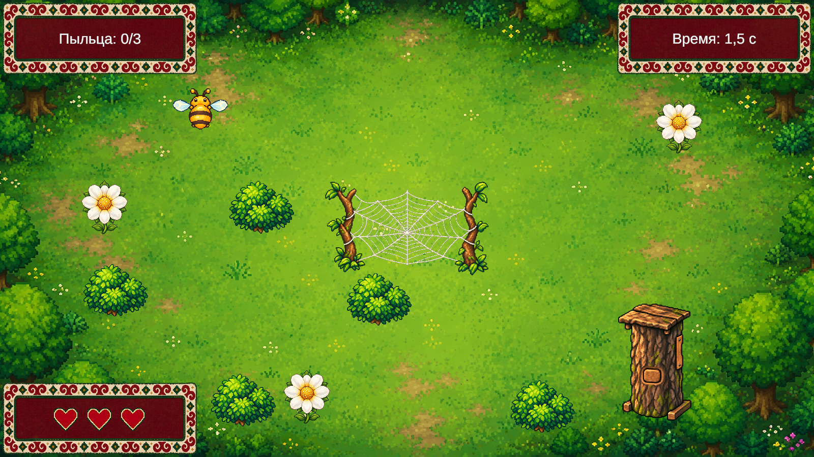

# Медовый путь — игровой прототип

Небольшая двумерная игра на Unity о пчёлке, которая собирает пыльцу, избегает паутины и возвращается в колодный улей. Тема проекта — башкирское лесное пчеловодство; интерфейс оформлен под войлок с орнаментом. «Медовый путь» — рабочее название.

## Открытие проекта

1. Скачайте ZIP через Code → Download ZIP и распакуйте его либо клонируйте репозиторий.
2. В Unity Hub выберите Add project from disk и укажите папку с Assets, Packages и ProjectSettings.
3. Откройте проект в Unity **2022.3.62f3**.
4. Откройте сцену `Assets/Scenes/BeeGlade.unity` и нажмите Play.

Управление: WASD или стрелки. Перезапуск: R.

## Что реализовано

- Движение пчёлки и анимация крыльев.
- Сбор пыльцы с цветков: после сбора цветок остаётся на месте и меняет вид.
- Здоровье, урон, возврат на старт, победа и поражение.
- Колодный улей: зона завершения срабатывает после сбора всей пыльцы.
- Горизонтальная и вертикальная паутина, кустики и редактируемые префабы.
- Войлочный интерфейс и два состояния сердечек.

Сейчас подключена одна игровая локация. Главное меню, пауза, вторая локация и звуковые эффекты ещё не реализованы.

## Расстановка объектов

Префабы находятся в `Assets/BeeGlade/Prefabs`. Редактируйте сцену при выключенном Play и сохраняйте изменения. `CobwebVertical` можно добавить на уровень вручную; по умолчанию на сцене оставлена горизонтальная паутина.

Второй снимок показывает вариант препятствия в той же локации, а не второй готовый уровень.

## Создание сборки Windows

В редакторе выберите Bee Glade → Build Windows game. Результат появится в `Builds/Windows`.

## Разработка

Проект сделан на основе авторской игры ThreeCrystals. Визуальные ассеты создавались с применением генерации изображений; скрипты и сборка прототипа дорабатывались с помощью ChatGPT/Codex. Исходные проектные файлы сохранены для редактирования в Unity.
